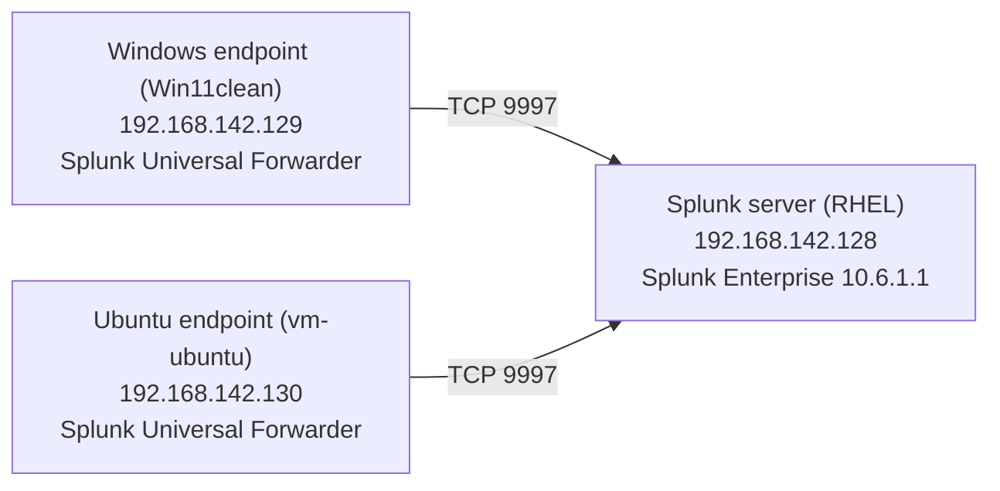
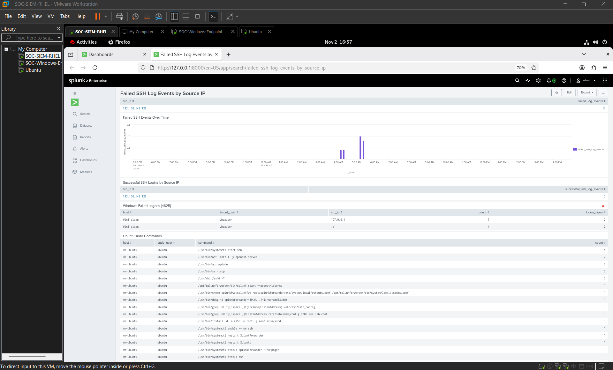
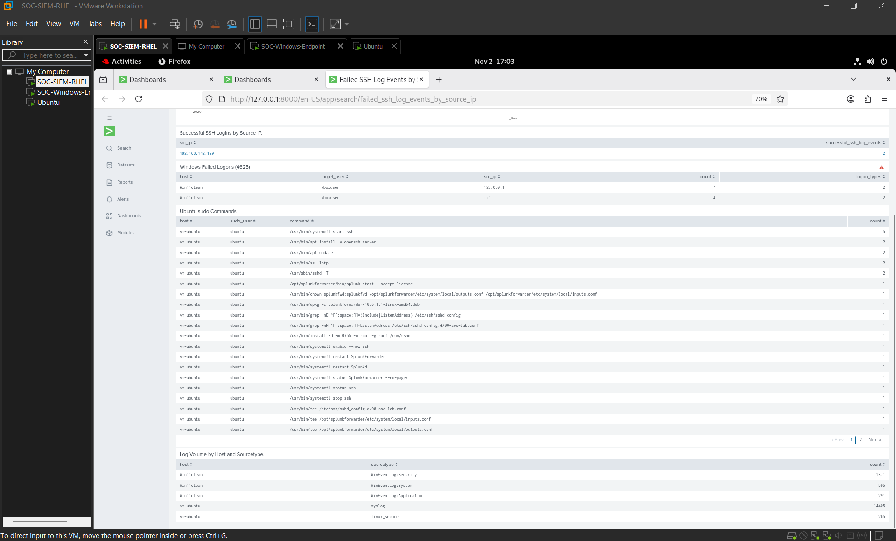
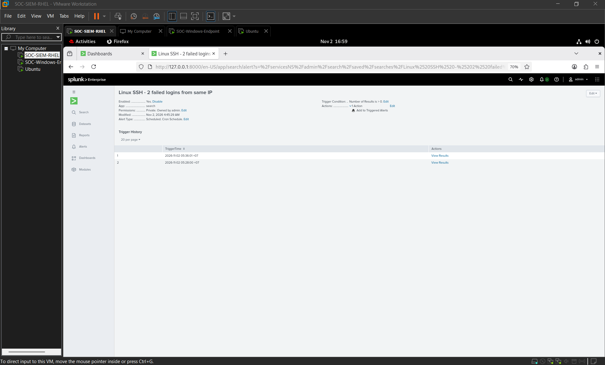

# Splunk SOC Home Lab

A small SOC monitoring lab that centralizes Windows and Ubuntu logs in Splunk Enterprise, then uses SPL searches, a dashboard, and a scheduled alert to review authentication and privilege activity.

## Lab topology

All three VMs use the lab network `192.168.142.0/24`.



| VM | Role | Address | Collected data |
|---|---|---:|---|
| SOC-SIEM-RHEL | Splunk receiver and search head | `192.168.142.128` | Receives forwarded events on TCP `9997` |
| SOC-Windows-Endpoint / `Win11clean` | Windows endpoint | `192.168.142.129` | Security, System, and Application event logs |
| Ubuntu / `vm-ubuntu` | Linux endpoint | `192.168.142.130` | `/var/log/auth.log` (`linux_secure`) and `/var/log/syslog` (`syslog`) |

Events are stored in the `main` index. From Windows, a connection test to `192.168.142.128:9997` succeeded. The Universal Forwarder service was observed running on Windows.

## Detection work

The lab generated and reviewed these event types:

- Failed SSH authentication against Ubuntu from the Windows endpoint.
- Successful SSH authentication against Ubuntu.
- Windows Security Event ID 4625.
- Ubuntu sudo command records.

The dashboard **Failed SSH Log Events by Source IP** contains panels for failed SSH events over time, successful SSH logins, Windows failed logons, Ubuntu sudo commands, and log volume by host and sourcetype.

The alert **Linux SSH - 2 failed logins from same IP** is enabled. It is scheduled using a one-minute cron interval, searches the last 15 minutes, triggers when the result count is greater than zero, and is throttled for five minutes. Its action adds an entry to Triggered Alerts. The alert history showed two firings.

## SPL searches

### Log volume by host and sourcetype

```spl
index=main earliest=-24h latest=now
| stats count by host sourcetype
| sort host -count
```

### Repeated failed SSH logins by source IP

```spl
index=main host=vm-ubuntu sourcetype=linux_secure "Failed password" earliest=-24h latest=now
| rex field=_raw "Failed password for (?:invalid user )?(?<user>\S+) from (?<src_ip>[0-9.]+)"
| stats count as failed_attempts values(user) as users by src_ip
| where failed_attempts >= 2
| sort -failed_attempts
```

### Successful SSH logins

```spl
index=main host=vm-ubuntu sourcetype=linux_secure "Accepted " earliest=-24h latest=now
| rex field=_raw "Accepted \S+ for (?<user>\S+) from (?<src_ip>[0-9.]+)"
| stats count by src_ip user
| sort -count
```

### Windows failed logons (Event ID 4625)

```spl
index=main host=Win11clean sourcetype=WinEventLog:Security EventCode=4625 earliest=-24h latest=now
| rex field=_raw "(?s)Account For Which Logon Failed:.*?Account Name:\s*(?<target_user>[^\r\n]+)"
| rex field=_raw "(?s)Network Information:.*?Source Network Address:\s*(?<src_ip>[^\r\n]+)"
| rex field=_raw "Logon Type:\s*(?<logon_type>\d+)"
| stats count values(logon_type) as logon_types by host target_user src_ip
| sort -count
```

### Ubuntu sudo commands

```spl
index=main host=vm-ubuntu sourcetype=linux_secure "COMMAND=" earliest=-24h latest=now
| rex field=_raw "sudo:\s+(?<sudo_user>\S+).*?COMMAND=(?<command>.*)"
| stats count by host sudo_user command
| sort -count
```

## Observed results

- The dashboard showed **13 failed SSH events** from `192.168.142.129` and **2 successful SSH logins** from that address.
- Windows Event ID 4625 records were associated with user `vboxuser`; observed source values included `127.0.0.1` and `::1`, with Logon Type 2. These are local interactive logons, not evidence of remote Windows logons.
- Ubuntu sudo records included commands such as `systemctl start ssh`, `apt update`, and `apt install openssh-server`.
- The host/sourcetype panel showed data for Windows Security, System, and Application logs, plus Ubuntu `syslog` and `linux_secure`.

Event counts depend on the dashboard time picker and each panel's search window. A previous standalone search and the dashboard panel showed different totals; compare counts only after aligning their time ranges.

## Limitations and follow-up

- Splunk displayed a warning that one rawdata event could not be read and that results might be incomplete. The Windows 4625 panel also showed a warning indicator. Treat those results as potentially incomplete until the affected bucket is investigated.
- The SSH alert's action is **Triggered Alerts** only. It does not send email or perform automatic response. Because it searches a rolling 15-minute window every minute, qualifying events can cause repeat triggers after the five-minute throttle expires.
- Kali is reserved for a later controlled simulation phase and is not part of the validated log flow documented here.
- The earlier plan listed `192.168.56.0/24`; the running lab observed during this work uses `192.168.142.0/24`. Use the actual VM addresses above when reproducing the current setup.


## Evidence

### Splunk dashboard




### SSH alert


No credentials or passwords should be committed.
